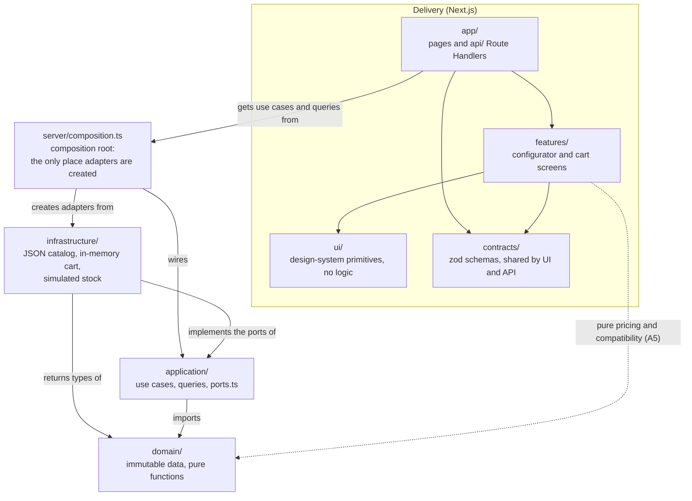
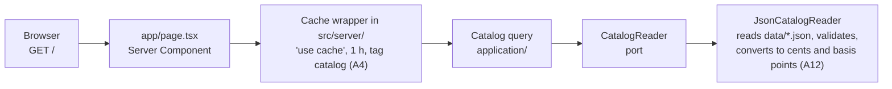
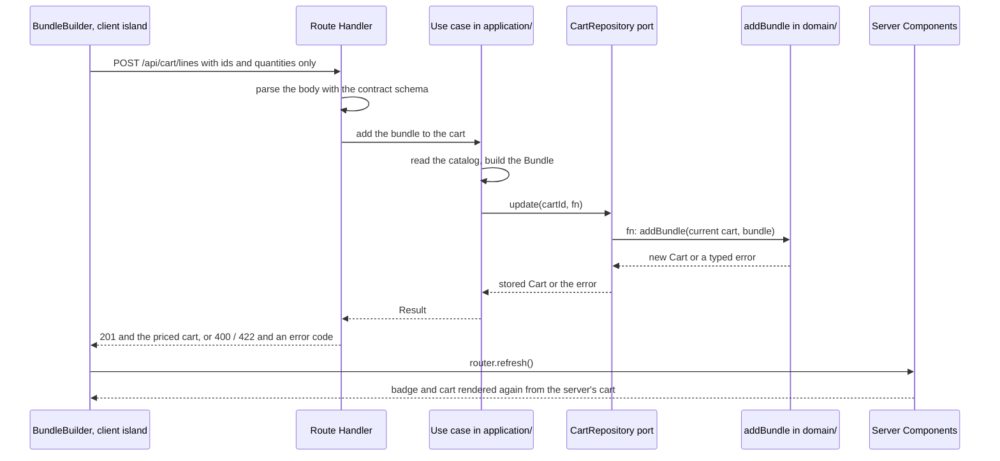

# 0001. Architecture of the bike bundle configurator

- **Status:** accepted
- **Date:** 2026-11-15
- **Covers:** decisions A1 to A14. Cite them by number in tasks and pull requests.
- **Related:** [0002. UI of the bike bundle configurator](0002-ui.md) (decisions U1 to U11), `AGENTS.md`, [`docs/brief.md`](../brief.md)

`AGENTS.md` fixes the layering, the ports, the request flows and the language. This record takes that as given and decides the 14 architecture questions it leaves open.

## Summary

| #   | Question                                      | Decision                                                                                                                                        |
| --- | --------------------------------------------- | ----------------------------------------------------------------------------------------------------------------------------------------------- |
| A1  | Cart identity and lifetime                    | Opaque `cart_id` cookie, 7 days, minted by the first write. The cart lives in a server store held on `globalThis`.                              |
| A2  | How the UI sees the cart                      | Server Components render the cart. Every write is followed by `router.refresh()`. There is no client cart state.                                |
| A3  | Rendering model                               | Keep Cache Components. Catalog cached, cart badge streamed, cart page rendered on every request.                                                |
| A4  | Catalog loading and caching                   | The adapter reads the JSON files with `fs.readFile`, behind `'use cache'` with an hourly lifetime, a `catalog` tag and a revalidation endpoint. |
| A5  | Server/Client boundary per screen             | Data, prices and validation on the server; small client islands for interaction. Bike selection is client state; pricing functions are shared.  |
| A6  | Route Handler surface and contracts           | Six endpoints, one error envelope, one status rule. Removing a missing cart line returns 404 `line-not-found`.                                  |
| A7  | Does "Add to cart" consult the stock service? | No. Stock is decided at checkout.                                                                                                               |
| A8  | The simulated stock service                   | An adapter with injected randomness, latency and settings. E2E tests run two server instances, one that never fails and one that always fails.  |
| A9  | Resilience policy                             | Availability: 2 s timeout, one retry. Reservation: 3 s timeout, no retry. Checkout sends an `Idempotency-Key`.                                  |
| A10 | How availability reaches the configurator     | The `BundleBuilder` island fetches it after hydration, once for all products.                                                                   |
| A11 | Shape of `CartRepository`                     | `get` and an atomic `update(cartId, fn)`. `save` is gone.                                                                                         |
| A12 | Money and tax arithmetic                      | The catalog adapter validates and converts to integer cents and basis points. One pure `taxOf` in `domain/`, half-up, once per cart line.       |
| A13 | Bonus scope                                   | Race conditions, A11y and Caching strategy.                                                                                                     |
| A14 | Order record and tests                        | No order port: checkout returns an order id and totals. Tests at five levels, each asserting observable behaviour.                              |

## Starting point: what `AGENTS.md` already settles

These points are restated so the decisions below can be read on their own. They are not reopened here.

- **Truth and money.** The server is the source of truth. The client never sends prices. Money is integer cents.
- **Layers.** `domain` (pure), `application` (use cases, queries, `ports.ts`), `infrastructure` (adapters), `contracts` (zod, shared by UI and API), `server/composition.ts` (the only place adapters are created), `app/`, `ui/`, `features/`.
- **Dependency direction**, enforced by ESLint: `domain` imports only `domain`; `application` imports `domain` and its ports; only the composition root imports `infrastructure`; `app/` and `features/` never do.
- **Ports.** `CatalogReader`, `CartRepository`, `StockService` and `IdempotencyStore`. Adapters: JSON catalog, in-memory cart, simulated stock.
- **Flows.** Reads: Server Component → query → port → adapter. Writes: Route Handler → contract schema → use case → `Result` mapped to an HTTP status. This also settles Route Handlers over Server Actions for writes.
- **Style.** Functional core, no classes in the domain, `Result` values for expected failures, discriminated unions, branded types. A `Cart` changes only through `addBundle`, `removeLine` and `clear`, so a cart line is a whole bundle and there is no "edit line".
- **Language.** Availability is a hint; the reservation at checkout is the decision; shortfall; stock unavailable; gross = net × (1 + taxRate), rounded per line.
- **Working rules.** Jest first, Playwright for E2E, Conventional Commits, contract and port changes in their own commit, npm.

### Layers and the direction of dependencies

An arrow points from a module to what it depends on. The dashed arrow is the one addition made by this record (A5).



### Read flow: loading the catalog



The adapter returns bikes and accessories as plain serialisable data. The page passes them as props to the client island (A5).

### Write flow: "Add to cart"



The client never sends a price; the server prices from the catalog. The client keeps no copy of the cart (A2). The `update` step is atomic (A11).

## Terms: bundle, cart line, cart

- **Bundle**: one bike plus the accessories chosen for it, each with a quantity from 0 to its `maxAmount`. It is what "Add to cart" adds (brief requirement 4: "add a bike + accessories as a bundle to the cart").
- **Cart line**: one bundle in the cart. It is priced as one unit (net summed, VAT rounded once for the line, A12) and removed as one unit.
- **Cart**: a list of cart lines and nothing else. There are no loose bikes or loose accessories in it.

Example from the catalog: Touring Voyager 5.0 + 2 × Urban Pro Bike Helmet + SecureLock Chain Lock 12mm + Aluminum Rear Rack + 3 × Compact Puncture Repair Kit is one bundle of 8 items: net €1,206.80, VAT €229.29, total €1,436.09. A cart of three such bundles shows 3 in the header badge.

What follows:

- The same bike configured twice gives two cart lines; they are never merged (A11).
- Placing the order reserves stock for every item of every bundle together. One short item fails the whole order, and the UI flags the bundle that contains it (U9).
- "Remove" takes out one bundle; "Clear cart" removes all of them.

**One reading of the brief to be aware of.** Requirement 5 says the customer can "delete individual items or the entire cart". In this design an individual item in the cart is one bundle. Taking a single accessory out of a bundle that is already in the cart is not offered, because `AGENTS.md` gives the cart only `addBundle`, `removeLine` and `clear`; the customer removes the bundle and configures it again. The README states this reading, because "individual items" can be read the other way.

## Criteria from the brief

The brief lists what the submission is judged on ([`docs/brief.md`](../brief.md), "What We Look At"). The reasons below name the criterion they answer:

- **boundary**: the boundary between Server and Client Components is deliberate.
- **stock**: the unstable stock service gets real error handling.
- **state**: state architecture decisions are justified.
- **tests**: tests check behaviour.
- **commits**: the commit history shows meaningful steps.
- **readme**: the README says what was left out.

## Findings the decisions rest on

### The framework as installed

The project runs Next.js 16.4.6 with `cacheComponents: true` and `partialPrefetching: true` in `next.config.ts`, the defaults `create-next-app` writes. The documentation shipped with that version (`node_modules/next/dist/docs/01-app/`) states:

- `01-getting-started/08-caching.md`: new App Router apps already have Cache Components and Partial Prefetching enabled. Reading `cookies()` under `<Suspense>` no longer makes the whole route dynamic. An async file read during render counts as uncached data; it must sit inside `'use cache'` or at module scope.
- `03-api-reference/03-file-conventions/02-route-segment-config/index.md`: with Cache Components the route segment options `dynamic`, `revalidate` and `fetchCache` are removed. The brief's "ISR/`revalidate`" bonus therefore means `'use cache'` + `cacheLife` + `cacheTag` + `revalidateTag`.
- `03-api-reference/04-functions/cookies.md`: cookies can be set only in a Route Handler or Server Function, never during a Server Component render.
- `01-getting-started/09-revalidating.md`: `updateTag` is for Server Actions only; Route Handlers use `revalidateTag(tag, 'max')`.
- `03-api-reference/04-functions/use-router.md`: `router.refresh()` re-renders Server Components and clears the Client Cache for the current route.
- `02-guides/preserving-ui-state.md`: on navigation Next.js hides the previous page with React `<Activity>` instead of unmounting it, and keeps up to 3 routes. Client state such as a half-configured bundle survives a trip to the cart and back. Hidden pages stay in the DOM, so tests need visibility-aware selectors.

### Spike 1: module-level state is not shared between pages and Route Handlers

A throwaway Next.js 16.4.6 app kept the cart in two places: a `Map` at module scope and a `Map` on `globalThis`. After one `POST /api/cart/lines`, a page render in the production build printed:

```text
badge global=1 module=0 load#1
```

and the handler's response carried `"moduleLoadIndex":2`. The store module was instantiated twice, once for the page bundle and once for the Route Handler bundle. The module-scoped cart was empty from the page's point of view; the `globalThis` one was shared.

**Finding: in-memory adapters must hang off `globalThis`.** This drives A1.

### Spike 2: a server-rendered cart stays fresh with `router.refresh()`

The same app rendered the cart badge in the root layout and the cart lines on `/cart`, both as Server Components reading the cookie under `<Suspense>`, with the catalog read from `data/bikes.json` inside `'use cache'`. Build output:

```text
Route (app)               Revalidate  Expire
┌ ◐ /                             1h      1d
├ ƒ /api/cart/lines
├ ƒ /api/cart/lines/[id]
└ ◐ /cart
◐ (Partial Prerender)  prerendered as static HTML with dynamic server-streamed content
```

Driven in headless Chromium, sampling what was painted every 25 ms:

| Step                                  | Painted                  |
| ------------------------------------- | ------------------------ |
| Load `/`                              | badge 0                  |
| Add (`POST`, then `router.refresh()`) | badge 0 → 1              |
| Client navigation to `/cart`          | 1 line, badge 1          |
| Remove on `/cart`                     | lines 1 → 0, badge 1 → 0 |
| Browser back to `/`                   | badge 0                  |
| Two rapid adds                        | badge 1 → 2              |
| Browser forward to `/cart`            | 2 lines, badge 2         |
| Client navigation `/` → `/cart` again | 2 lines, badge 2         |
| Hard reload of `/cart`                | 2 lines, badge 2         |

No stale state was painted at any step. A second run let `<Link>` prefetch `/cart`, then changed the cart, then navigated:

| Cart read                            | Requests during the navigation          | Painted                |
| ------------------------------------ | --------------------------------------- | ---------------------- |
| plain `cookies()` read               | none (served from the prefetched shell) | 2 lines directly       |
| `await connection()` before the read | one RSC request                         | fallback, then 2 lines |

In the first variant the cart is part of the client-cached App Shell. It was fresh only because `router.refresh()` made Next.js prefetch `/cart` again. A write that does not go through this tab (a second tab, an expired cart) would leave a stale cart on screen until the next refresh.

**Finding: `router.refresh()` after every write keeps a server-rendered cart fresh, and the cart page needs `connection()` to be read on every visit.** This drives A2 and A3.

### Money arithmetic on the catalog

```text
79.9*100  = 7990.000000000001        34.95*100 = 3495.0000000000005
16.5*1.19 = 19.634999999999998  -> toFixed(2) "19.63", integer half-up 19.64   (acc-006)
39.5*1.19 = 47.004999999999995  -> toFixed(2) "47.00", integer half-up 47.01   (acc-014)
```

Two of the 26 products get a gross price one cent too low with float arithmetic. Rounding granularity, on the largest possible bundle for two bikes (all at 19 % VAT):

```text
bike-001 Touring  net 2222.70  per line 2645.01  per position 2645.01  per unit 2645.03
bike-008 E-Cargo  net 5779.80  per line 6877.96  per position 6877.96  per unit 6877.98
```

Rounding per unit drifts by 2 cents. A full Touring bundle holds 11 different product types and a full E-Cargo bundle 12, which matters for the "max. 10 product types" bonus (A13).

**Finding: prices must be converted to integer cents before any arithmetic, and tax must be rounded once per line.** This drives A12.

## A1. Cart identity and lifetime

**Decision.** An opaque `cart_id` cookie identifies the cart; the cart itself lives in the server store.

- Cookie `cart_id` = `crypto.randomUUID()`, `HttpOnly`, `SameSite=Lax`, `Path=/`, `Secure` in production, lifetime 7 days.
- The cookie is minted lazily by the first write handler. Cookies cannot be set during a Server Component render, and a visitor who never adds anything gets no cookie and no store entry.
- A cookie that names no stored cart (after a restart) reads as an empty cart; the next write reuses the id.
- The in-memory adapters are created once and stored on `globalThis` by `server/composition.ts`.

**Context.** The cart lives on the server behind `CartRepository` with an in-memory adapter (settled). Open were: how a browser is tied to its cart, when that tie is created, and how long the cart lives. Requirement 6 wants the cart kept across navigation.

**Options considered.**

| Option                                                   | For                                                                                                                               | Against                                                                                                        |
| -------------------------------------------------------- | --------------------------------------------------------------------------------------------------------------------------------- | -------------------------------------------------------------------------------------------------------------- |
| **a. Opaque `cart_id` cookie, cart in the server store** | Matches the settled adapter. The cookie carries no data, so there is nothing to sign or validate. Survives navigation and reload. | Lost on server restart. One instance only.                                                                     |
| b. Whole cart in a signed cookie                         | Survives restarts and scales out                                                                                                  | A different adapter from the settled one; 4 KB limit; needs a signing secret; stale prices live in the browser |
| c. `localStorage`                                        | No server state                                                                                                                   | Contradicts "the server is the source of truth"                                                                |

For the lifetime, minutes, 7 days and 30 days were weighed. A lifetime of minutes would empty the cart of a customer who comes back after lunch. A cart holds no stock, so a long life costs nothing. A week covers comparing bikes over a few days, which 30 days is not needed for.

**Reason.** The persistence story is one sentence with a stated limit, and the limit is exactly what the `CartRepository` port exists to lift. Spike 1 shows why the store hangs off `globalThis`: a module-level singleton is not shared between pages and Route Handlers. Criterion: state.

**Consequence for the README.** The app needs one long-lived Node.js process (a container), because cart, stock and idempotency records are in memory. Serverless or several instances need a Redis or database adapter, which the port already allows: one new adapter and one line in `server/composition.ts`.

## A2. How the UI sees the cart

**Decision.** Server Components render the cart. Every write is followed by `router.refresh()`. There is no client cart state. One client helper performs every cart write (fetch, map the error, then `router.refresh()` inside a transition), so no write can forget the refresh.

**Context.** The server holds the cart. The header badge and the cart page must show it and stay correct after add, remove, clear and checkout, across navigation, back/forward and reload.

**Options considered.**

| Option                                                                                                        | For                                                                                                                                                                               | Against                                                                                                      |
| ------------------------------------------------------------------------------------------------------------- | --------------------------------------------------------------------------------------------------------------------------------------------------------------------------------- | ------------------------------------------------------------------------------------------------------------ |
| **a. Server Components render the cart; every write is followed by `router.refresh()`; no client cart state** | One copy of the cart. Requirement 6 holds by construction. Verified in Spike 2. Responses cannot arrive out of order and overwrite newer state, because the UI never stores them. | Each write costs a second request. Immediate (optimistic) feedback needs `useOptimistic` on top.             |
| b. Client cart context seeded by the server, replaced from each write response                                | One request per write. A natural base for optimistic UI.                                                                                                                          | Two copies to keep in step; needs response ordering (version numbers); the cart page becomes client-rendered |
| c. TanStack Query or SWR                                                                                      | Handles caching, retries and ordering                                                                                                                                             | A dependency to justify for one resource; moves the data model into the browser                              |
| d. Client-only store                                                                                          | Simplest client                                                                                                                                                                   | Contradicts the settled source of truth                                                                      |

**Reason.** The justification is short and checkable: there is no client cart to drift, so "preserved across navigation" cannot break. When the Optimistic UI bonus is built in a later iteration, it is layered on with `useOptimistic`; the model does not change. Criteria: state, boundary.

## A3. Rendering model: keep Cache Components

**Decision.** Keep Cache Components and place each piece deliberately:

| Piece                        | Kind                             | How                                                           |
| ---------------------------- | -------------------------------- | ------------------------------------------------------------- |
| Page chrome, headings        | static                           | plain Server Components                                       |
| Catalog (bikes, accessories) | cached                           | `'use cache'` + `cacheLife('hours')` + `cacheTag('catalog')`  |
| Header cart badge            | streamed                         | async Server Component under `<Suspense>`, reads the cookie   |
| Cart page contents           | streamed, **always per request** | under `<Suspense>`, with `await connection()` before the read |
| Availability                 | client fetch                     | A10                                                           |

**Context.** The project has Cache Components enabled by default. Under it every component is one of: static (in the prerendered shell), cached (`'use cache'`, in the shell), or streamed per request (under `<Suspense>`). The app has all three kinds of data: catalog (the same for everyone), cart (per visitor), availability (per moment).

**Options considered.**

| Option                                                      | For                                                                                                                                          | Against                                                                                                                                 |
| ----------------------------------------------------------- | -------------------------------------------------------------------------------------------------------------------------------------------- | --------------------------------------------------------------------------------------------------------------------------------------- |
| **a. Keep Cache Components; place each piece deliberately** | It is the framework default, visible in `next.config.ts`. Catalog pages keep a static shell even though the header shows a per-visitor cart. | Newer model; needs `<Suspense>` around every cookie read                                                                                |
| b. Turn it off and use the previous model                   | Familiar `export const revalidate`                                                                                                           | Reading the cart cookie in the layout makes every route fully dynamic; fights the default setup; `revalidate` config is the legacy path |
| c. Static pages; fetch cart and catalog from the client     | Trivially static                                                                                                                             | Spinner-driven UI; requirement 8 wants the catalog loaded server-side                                                                   |

**Reason.** Each piece has a stated reason for where it renders, and the build output (`◐ /`, `◐ /cart`) shows it. `connection()` on the cart page is deliberate: Spike 2 shows that without it the cart is served from a client-cached shell with no request. That is instant, but a cart changed elsewhere would be displayed stale on the page where the customer places the order. One request per visit to the cart buys a cart that is never stale there. The badge may ride the shell; it is refreshed after every write. Criterion: boundary.

## A4. Catalog loading and caching

**Decision.** The catalog adapter reads the JSON files with `fs.readFile`, and the read is wrapped in `'use cache'`.

- `JsonCatalogReader` (infrastructure) reads both files, validates the raw shape, and maps to domain types: `price` → integer cents, `taxRate` → basis points (A12). Invalid data throws: a broken catalog is a bug, not an expected failure.
- The cache wrapper lives in `src/server/` beside the composition root, not in `application/`, because `cacheLife` and `cacheTag` are Next.js imports and `application` must stay framework-free.
- `cacheLife('hours')` and `cacheTag('catalog')`. In Spike 2 this built `/` with revalidate 1h, expire 1d.
- `POST /api/revalidate`, guarded by a secret from the environment, calls `revalidateTag('catalog', 'max')`. This is the Caching strategy bonus (A13).
- Domain data is serialisable (settled), which `'use cache'` requires of its return value.

**Context.** Requirement 8: the catalog is loaded server-side. `CatalogReader` has a JSON adapter (settled). Open were: how the adapter reads, where validation and unit conversion happen, where the cache lives, and how it is refreshed.

**Options considered.**

| Option                                                        | For                                                                              | Against                                                         |
| ------------------------------------------------------------- | -------------------------------------------------------------------------------- | --------------------------------------------------------------- |
| a. `import bikes from 'data/bikes.json'`                      | Simplest; typed by inference                                                     | Bundled at build; nothing to cache or revalidate; no validation |
| b. Read once at module scope                                  | The Next.js docs recommend it for files that never change                        | No lifetime, no tag; a data change needs a redeploy             |
| **c. `fs.readFile` in the adapter, wrapped in `'use cache'`** | Real I/O with a lifetime and a tag; the same shape a database adapter would have | A few more lines                                                |

**Reason.** Caching is a delivery concern placed where framework code is allowed, and the Caching strategy bonus costs about half an hour because the structure is already there. Importing the JSON would nearly do for a prototype; the file read stays because the Caching strategy bonus is built, and an imported file leaves nothing to cache or refresh. Criteria: boundary, readme.

## A5. Server/Client boundary per screen

**Decision.** The rule: **data, prices and validation on the server; only interaction on the client; a client island is as small as the interaction it owns.**

| Screen           | Server Components                                                       | Client islands                                                                  |
| ---------------- | ----------------------------------------------------------------------- | ------------------------------------------------------------------------------- |
| Layout           | shell, nav, `CartBadge` (streamed)                                      | none                                                                            |
| Configurator `/` | the page loads the cached catalog and renders the static frame          | `BundleBuilder`: bike selection, sliders, live price, availability, Add to cart |
| Cart `/cart`     | lines, per-line and total prices, empty state, all priced on the server | `RemoveLineButton`, `ClearCartButton`, `CheckoutPanel` (button and result)      |
| Order result     | none needed                                                             | rendered by `CheckoutPanel` from the checkout response (U9)                     |

Three points within this decision:

1. **The bike selection is client state.**
2. **The live bundle price is computed on the client with the same pure domain functions the server uses.** The ESLint dependency rule allows `features/` to import `domain/`. The server still recomputes on add and never reads a price from the request.
3. **Compatibility is checked on both sides.** The client uses the domain's compatibility function to group and disable accessories; the server re-checks on add and answers 422 for an incompatible accessory or a quantity above `maxAmount`.

**Context.** The boundary between Server and Client Components is the first criterion in the brief. The three screens have different jobs, so the boundary sits in a different place on each.

**Options considered.**

Where the bike selection lives:

| Option                                     | For                                                                                                                                                                           | Against                                                             |
| ------------------------------------------ | ----------------------------------------------------------------------------------------------------------------------------------------------------------------------------- | ------------------------------------------------------------------- |
| **Client state**                           | Switching bikes is instant and needs no request. The page keeps its static shell. `<Activity>` preserves the half-built bundle when the customer visits the cart and returns. | The selection is not shareable by URL and is lost on reload         |
| A `?bike=` search param read on the server | Shareable URL                                                                                                                                                                 | A request per click to compute something the browser already has    |
| One route per bike                         | Shareable URL; the server filters accessories                                                                                                                                 | Two routes and a request per bike for the same requirement (see U2) |

How the configurator gets its live price:

| Option                                              | For                                                                                                                     | Against                                                           |
| --------------------------------------------------- | ----------------------------------------------------------------------------------------------------------------------- | ----------------------------------------------------------------- |
| **Shared pure domain functions, run on the client** | The domain is pure TypeScript and serialisable, so one implementation of pricing runs on both sides and cannot disagree | `features/` imports `domain/`, which the ESLint rule has to allow |
| Ask the server on every change                      | The server stays the only place that computes                                                                           | A request for every slider step                                   |
| Show no total until the bundle is added             | No client pricing at all                                                                                                | The customer sets quantities without seeing what they cost        |

**Reason.** Three screens have three different boundary positions, each explained by what the screen has to do. The cost of client-side selection is accepted and stated in the README: the selection is not shareable by URL and is lost on reload. Criterion: boundary.

## A6. Route Handler surface and contracts

**Decision.**

| Endpoint                          | Body or query                                          | Success                                        | Expected failures                                                                                                                                                                                         |
| --------------------------------- | ------------------------------------------------------ | ---------------------------------------------- | --------------------------------------------------------------------------------------------------------------------------------------------------------------------------------------------------------- |
| `POST /api/cart/lines`            | `{ bikeId, accessories: [{ accessoryId, quantity }] }` | 201 `CartView` (sets `cart_id` if missing)     | 400 `invalid-request`; 422 `unknown-bike`, `unknown-accessory`, `incompatible-accessory`, `quantity-out-of-range`                                                                                         |
| `DELETE /api/cart/lines/{lineId}` | none                                                   | 200 `CartView`                                 | 404 `line-not-found`                                                                                                                                                                                      |
| `DELETE /api/cart`                | none                                                   | 200 `CartView` (empty)                         | none                                                                                                                                                                                                      |
| `GET /api/availability?ids=…`     | product ids                                            | 200 `{ items: [{ productId, available }] }`    | 400 `invalid-request`; 503 `stock-unavailable`                                                                                                                                                            |
| `POST /api/checkout`              | header `Idempotency-Key`                               | 200 `{ status: "confirmed", orderId, totals }` | 400 `invalid-request` (missing or malformed `Idempotency-Key`); 409 `shortfall` with `details.items: [{ productId, requested, available }]`; 409 `cart-empty`; 503 `stock-unavailable` with `Retry-After` |
| `POST /api/revalidate`            | secret header                                          | 204                                            | 401 `unauthorized`                                                                                                                                                                                        |

- No price ever appears in a request body.
- `CartView` is the server-priced projection: lines with positions; net, tax and gross per line; cart totals; all in cents. Formatting is the UI's job.
- One error envelope for every non-2xx response, checkout included: `{ error: { code, message, details? } }`. `code` is a closed union in `contracts/`; the UI switches on it, never on message text. The failures column lists these codes.
- `CheckoutResult` stays the application's discriminated union. The checkout handler maps `confirmed` to the 200 body and each failure variant to the envelope: `shortfall` (409, the short positions in `details.items`), `cart-empty` (409) and `stock-unavailable` (503, the same code as `GET /api/availability`).
- Removing a line that does not exist returns 404 `line-not-found`. The UI treats it as already removed and refreshes.
- Handlers read the cart id from the `NextRequest` and set it on the `NextResponse`, not through `cookies()`.
- Handlers run on the Node.js runtime (in-memory state, `fs`).
- Status rule: 400 the request is malformed; 401 the caller lacks the secret; 422 it is well-formed but breaks a domain rule; 409 it conflicts with current state; 503 a dependency failed and retrying may work.

**Context.** The brief wants at least one Route Handler; the settled write flow makes Route Handlers the only write path. Open were: which endpoints exist, what they return, and how a `Result` maps to HTTP.

**Options considered.**

- **A `GET /api/cart` endpoint.** Not built: Server Components read the cart through the query, so the endpoint would have no caller.
- **Reading and setting the cookie through `cookies()`.** Not used in handlers: with the id taken from the request and set on the response, a Jest test can call a handler with a plain `Request`.
- **Answering success when the line to remove is already gone.** Not chosen: 404 `line-not-found` is consistent with `removeLine` returning a typed error in the domain. The customer sees no difference, because the UI treats the 404 as already removed.

**Reason.** The stock outcomes are distinct HTTP statuses with distinct error codes in one envelope, so "the stock service is failing" is a first-class response and can be asserted over HTTP. Criteria: stock, tests.

## A7. Does "Add to cart" consult the stock service?

**Decision.** No. "Add to cart" validates and prices only. Stock is decided at checkout.

**Context.** The settled language says availability is a hint and the reservation at checkout is the decision. The Optimistic UI bonus, however, asks for "a clean rollback with user feedback in case of a stock error" on "Add to cart", which only exists if adding can fail on stock. The two questions are therefore one decision, taken together with the bonus scope (A13).

**Options considered.**

| Option          | Behaviour                                                                        | For                                                                                             | Against                                                         |
| --------------- | -------------------------------------------------------------------------------- | ----------------------------------------------------------------------------------------------- | --------------------------------------------------------------- |
| **a. No**       | Add validates and prices only. Stock is decided at checkout.                     | Matches the settled language. One fewer place where a 10 % failure hits the customer. Simplest. | The Optimistic UI rollback has no stock case to show.           |
| b. Yes, strict  | Add checks availability; a shortfall or a failed stock service rejects the add.  | Exactly the scenario the Optimistic UI bonus describes.                                         | A flaky dependency blocks a step where nothing is at stake yet. |
| c. Yes, lenient | Only a confirmed shortfall rejects; a failed stock service lets the add through. | Kindest to the customer                                                                         | Most rules to explain and test                                  |

**Reason.** The Optimistic UI bonus is not built in this iteration (A13), so nothing calls for a stock check on add, and option a matches the settled language. Either answer is defensible if stated; an unstated mix is not. A stock call on add is revisited together with the Optimistic UI bonus (see "Deferred to a later iteration"). Criterion: stock.

## A8. The simulated stock service

**Decision.**

- **Shape.** Two operations: read availability for a list of products; reserve a list of `{ productId, quantity }`. Both return a `Result`: a value, or `stock-unavailable`. Reserve can also return `shortfall` with the short positions.
- **Latency.** Uniform 200 to 1200 ms per call.
- **Failure.** 10 % of calls return `stock-unavailable`, decided before any effect, so a failed reservation never takes stock.
- **Stock levels.** The data has no stock field. Levels are derived deterministically from the product id and a seed, in memory, with a spread that includes zero and low counts so every UI state is reachable. A successful reservation decrements all positions or none. Stock resets on restart.
- **Injection.** The adapter takes `random`, `sleep` and its settings as constructor arguments. The composition root passes `Math.random`, a real timer, and values from the environment: `STOCK_FAILURE_RATE` (default 0.1), `STOCK_LATENCY_MIN_MS`, `STOCK_LATENCY_MAX_MS`, `STOCK_SEED`. Unit tests pass fixed functions.
- **E2E determinism.** Playwright starts two server instances from the same build, one with failure rate 0 and one with failure rate 1.

**Context.** The brief asks for artificial latency and about 10 % errors, built however we like. The service is an adapter behind `StockService`. Open were: what it simulates, how it is configured, and how tests stay deterministic.

**Options considered** for making the failure path reproducible in E2E tests:

| Option                                                                             | For                                                               | Against                                          |
| ---------------------------------------------------------------------------------- | ----------------------------------------------------------------- | ------------------------------------------------ |
| **1. Two server instances from the same build, failure rate 0 and failure rate 1** | Tests the real server path. Adds no test hook to production code. | Two `webServer` entries in the Playwright config |
| 2. Intercept the request in the browser                                            | No second server                                                  | Tests only the client                            |
| 3. A test-only header that forces a failure                                        | One server                                                        | Ships a backdoor                                 |

**Reason.** The failure path is exercised end to end and reproducibly, and the README can tell a reader how to see it: `STOCK_FAILURE_RATE=1 npm start`. Criteria: stock, tests.

## A9. Resilience policy: what each caller does when stock fails

**Decision.** The policy differs by call because the stakes differ.

| Call                              | Timeout | Server retry                                | On failure                                                                                |
| --------------------------------- | ------- | ------------------------------------------- | ----------------------------------------------------------------------------------------- |
| Availability (read, a hint)       | 2 s     | one retry, because a read is safe to repeat | 503. The UI shows "Stock unknown" with Retry and never blocks configuring or adding (U5). |
| Reservation (write, the decision) | 3 s     | **none**                                    | `stock-unavailable`: cart untouched, clear message, "Try again" (U9)                      |

- **Timeouts** turn into `stock-unavailable`, so callers have one failure to handle.
- **Double submission.** The checkout button disables while pending and sends an `Idempotency-Key`. The key is separate from the cart cookie and is sent only with "Place order". The `IdempotencyStore` returns the stored outcome for a repeated key and shares the in-flight result with a concurrent duplicate, so there is one reservation however often the button is pressed. Only `confirmed` is stored; a transient failure is not, so "Try again" can succeed.
- **Reservation key.** The reservation call, with its 3 s timeout, is also shared under a key of the cart and its lines, so a duplicate while it runs joins it and a success is not repeated. A timed-out or failed reservation is forgotten and a retry reserves afresh.

**Context.** Handling of the unstable stock service is the second criterion in the brief. Requirement 7 asks for a clear message "including the case where the stock service is currently failing".

**Options considered** for retrying the reservation at checkout:

| Option                              | For                                                                                       | Against                                                                                                                      |
| ----------------------------------- | ----------------------------------------------------------------------------------------- | ---------------------------------------------------------------------------------------------------------------------------- |
| **No automatic retry**              | Never repeats a write whose effect is unknown. The customer decides to repeat a purchase. | Roughly one checkout in ten shows the failure message                                                                        |
| One or two automatic server retries | Hides about 99 % of failures                                                              | Safe only if the downstream call is idempotent; a real stock service that failed may or may not have applied the reservation |
| Automatic client retry with backoff | Hides most failures without server changes                                                | The same unknown, and the purchase is repeated without the customer asking                                                   |

**Reason.**

- Retrying a write is safe only if the downstream call is idempotent, and a real stock service that failed may or may not have applied the reservation. Not retrying blindly is the honest default.
- The customer, not the server, decides to repeat a purchase.
- Requirement 7 is about showing this state. With roughly one failure in ten checkouts, anyone running the app meets it without configuration.

Each call site has a stated, different policy with a reason. Criterion: stock.

## A10. How availability reaches the configurator

**Decision.** The `BundleBuilder` island fetches `GET /api/availability` after hydration: one request for all 26 products on mount, so switching bikes needs no further call. It refetches on Retry and after a shortfall at checkout. A newer request aborts an older one (`AbortController`).

**Context.** Availability changes from moment to moment and comes from a service that is slow and fails about one time in ten. The configurator shows it for bikes and accessories (U5).

**Options considered.**

| Option                                                                            | For                                                                                                                                        | Against                                                                                        |
| --------------------------------------------------------------------------------- | ------------------------------------------------------------------------------------------------------------------------------------------ | ---------------------------------------------------------------------------------------------- |
| **a. The `BundleBuilder` island fetches `GET /api/availability` after hydration** | The page keeps its static shell. The island owns loading, error and retry. A slow or failing stock service cannot delay or break the page. | A second request after load                                                                    |
| b. Stream it from the server under `<Suspense>`                                   | No client fetch code                                                                                                                       | Ties a 200 to 1200 ms, 10 %-failing call to page rendering; a retry means refreshing the route |
| c. Put it in the cached catalog                                                   | One read                                                                                                                                   | Stock is not catalog data; caching it would serve wrong numbers                                |

**Reason.** The unstable dependency is isolated behind the smallest surface that can show its three states. Criteria: stock, boundary.

## A11. Concurrency: the shape of `CartRepository`

**Decision.** `CartRepository` has `get(cartId)` for reads and the atomic `update(cartId, fn)` for writes. `fn` is a pure domain function returning a new `Cart` or a typed error; the cart is stored only if it succeeds, and updates of one cart never interleave.

- Each cart line gets its own id, so two identical bundles are two lines and are never merged.
- Two quick adds therefore both land.
- The Race conditions bonus (A13) covers the quantity slider, the quick adds (this decision) and the double click on "Place order" (the `Idempotency-Key`, A9).
- A second known limit for the README: a cart changed in another tab while a checkout is in flight is not guarded against.

**Context.** The Race conditions bonus names two cases: dragging the slider quickly, and adding several times in quick succession.

- **Slider.** Quantities are local state in `BundleBuilder`. Dragging sends nothing; the bundle is sent once, on Add. There is nothing to race.
- **Rapid adds.** A use case that does `get` → `await` something → `save` can lose an update when two requests interleave.

**Options considered.**

| Option                                                                                                                                      | For                                                                                                                                                                                     | Against                                                   |
| ------------------------------------------------------------------------------------------------------------------------------------------- | --------------------------------------------------------------------------------------------------------------------------------------------------------------------------------------- | --------------------------------------------------------- |
| a. `get(cartId)` and `save(cart)`                                                                                                           | Familiar                                                                                                                                                                                | Lost updates as soon as a use case awaits between the two |
| b. `update(cartId, fn)` where `fn` is a pure domain function returning a new `Cart` or a typed error, plus `get` for reads (**chosen**) | Atomic by contract. The in-memory adapter runs `fn` synchronously; a database adapter would use a transaction. Fits the functional core: `update(id, cart => addBundle(cart, bundle))`. | One method to learn                                       |

**Reason.** Option b closes the race in the port, where a later database adapter inherits the guarantee, and it remains the target design. The port change went in its own commit, as the working rules require. Criterion: state.

## A12. Money and tax arithmetic

**Decision.**

- **The adapter validates, then converts.** `cents = Math.round(price * 100)`. Loading fails if the price is not finite, is negative, or has more than two decimals: `Math.abs(price * 100 - cents) < 1e-6` must hold. A price like `12.345` in the JSON stops the app at load instead of being rounded unnoticed. The raw float never enters the domain (`79.9 * 100` is `7990.000000000001`, which passes the check and becomes 7990). The tax rate gets the same checks against whole basis points (0.19 → 1900). All 10 bikes and 16 accessories in the catalog pass, and the catalog has a single rate, 0.19.
- **One pure function in `domain/`:** `taxOf(net: Cents, rate: TaxRateBp): Cents`, with branded types, integer half-up: `floor((net × rate + 5000) / 10000)`. Gross is `net + taxOf(net, rate)`; nothing else computes tax.
- **A fixed test list for `taxOf`:**
  - the two products that floats price one cent low: 1650 → 314 and 3950 → 751 (both are exact half-cent cases, 313.5 and 750.5);
  - a further half-cent case: 50 → 10;
  - zero: 0 → 0;
  - a line with two different rates, rounded once per rate. The second rate in that test is made up, because the catalog has only 19 %.
- **A doc comment on `taxOf`:** half-up with `floor` is only correct for amounts that are not negative. `Cents` cannot be negative, and refunds are out of scope.
- **"Per line"** means once per cart line (a bundle) on the line's summed net, per tax rate. If a bundle ever mixes rates, each rate group in the line is rounded once. Cart totals are sums of line values, never re-rounded.

**Context.** Money is integer cents and gross is rounded per line (settled). Open were: how decimal JSON prices become cents, how the tax rate is held, the rounding mode, and what "per line" means when a bundle holds several products.

**Options considered** for rounding granularity:

| Option                                    | Result on a full Touring bundle (net €2,222.70) | Assessment                                         |
| ----------------------------------------- | ----------------------------------------------- | -------------------------------------------------- |
| Per unit                                  | €2,645.03                                       | Drifts by 2 cents from the line's own gross        |
| Per position (one product × its quantity) | €2,645.01                                       | Agrees with per line on this catalog               |
| **Per line**                              | €2,645.01                                       | The granularity the ubiquitous language prescribes |

Float arithmetic was ruled out by the findings above: it prices two of the 26 products one cent too low.

**Reason.** These are pure functions with exact expected values, the cheapest behaviour tests in the project. Rejecting bad input in the adapter means a wrong price stops the app at load instead of being rounded unnoticed. Criterion: tests.

**What production would do.** A real shop would store gross prices (German consumer price display must show the total price including VAT), round VAT per rate, and take the rate from the destination country under the EU One-Stop-Shop scheme (OSS), most likely through a tax engine. Net-first with a single rate is a deliberate choice for the challenge data, which supplies net prices and a `taxRate` per product.

## A13. Bonus scope and time budget

**Decision.** Three bonuses are built: **Race conditions, A11y and Caching strategy.** Optimistic UI, the limit of 10 product types and i18n are deferred (see "Deferred to a later iteration"). If time runs short, Caching strategy shrinks to its README paragraph. The README lists what was left out and why.

**Context.** The brief: 8 to 12 hours in total, pick 2 or 3 bonuses, "better to implement 2 of these cleanly than all of them halfway". Core estimate, with the project bootstrap already done:

| Core work                                                         | Hours   |
| ----------------------------------------------------------------- | ------- |
| Domain and pricing, with tests                                    | 2.0     |
| Ports, use cases, in-memory adapters, simulated stock, with tests | 1.75    |
| Contracts and Route Handlers, with handler tests                  | 1.25    |
| UI primitives and configurator                                    | 2.0     |
| Cart, checkout and result states                                  | 1.5     |
| E2E, README, deployment note                                      | 1.0     |
| **Core**                                                          | **9.5** |

That leaves about 2.5 hours.

**Options considered.**

| Bonus                     | Hours | What it shows                                                                                                                                          | Decision  |
| ------------------------- | ----- | ------------------------------------------------------------------------------------------------------------------------------------------------------ | --------- |
| Race conditions           | 1.0   | State and stock handling. The slider and the double submit fall out of A2 and A9; the quick-add case is closed by the atomic update (A11).                | **Build** |
| A11y                      | 1.0   | Quality throughout. Cheap because the primitives use native controls (U10).                                                                            | **Build** |
| Caching strategy          | 0.5   | Boundary and README. The structure exists (A3, A4); the work is the endpoint and the README paragraph.                                                 | **Build** |
| Optimistic UI             | 2.0   | Stock and state handling. Highest signal, highest risk; it changes A7.                                                                                 | Deferred  |
| Limit of 10 product types | 1.5   | A domain rule and a progress bar. Not among the brief's criteria. One full Touring bundle already holds 11 types, which opens product questions.       | Deferred  |
| i18n                      | 3.0   | Needs German names for 26 products and touches every screen.                                                                                           | Deferred  |

**Reason.** The three chosen bonuses take 2.5 hours, for a total of 12, and each builds on structure the core already needs. The brief says prioritisation is part of the evaluation. Criterion: readme.

## A14. Order record and tests

**Decision: order record.** There is no order port. Checkout generates an order id, returns it with the totals, and clears the cart. The order cannot be looked up afterwards; the README says so.

**Decision: tests.** What is tested where:

| Level          | Tool                                           | Examples                                                                                                                                                                                           |
| -------------- | ---------------------------------------------- | -------------------------------------------------------------------------------------------------------------------------------------------------------------------------------------------------- |
| Domain         | Jest, pure functions                           | gross of 16.50 at 19 % is 19.64; `addBundle` rejects an incompatible accessory and a quantity above `maxAmount`; removing a line; totals                                                           |
| Application    | Jest, in-memory adapters, a fake stock service | checkout confirmed clears the cart; shortfall and stock-unavailable leave it intact; a repeated idempotency key reserves once                                                                      |
| Route Handlers | Jest, calling the handler with a `Request`     | status and body for each row of A6                                                                                                                                                                 |
| UI             | Testing Library                                | incompatible accessories cannot be changed; a slider stops at `maxAmount`; the stock-unavailable message offers a retry                                                                            |
| E2E            | Playwright                                     | configure → add → the cart persists across navigation and reload → order confirmed; on the second server with failure rate 1, the order shows the stock-unavailable message and the cart is intact |

E2E selectors must be visibility-aware (role-based), because `<Activity>` keeps hidden pages in the DOM. The test "two concurrent adds yield two lines" arrives with the atomic `update` (A11); with `get` and `save` that outcome is not guaranteed.

**Context.** The order result is shown inline on the cart page (U9), so nothing needs to read an order after checkout. The brief asks for unit tests and at least one integration or E2E test, and judges whether tests check behaviour.

**Options considered.** An `OrderRepository` port with an adapter would make the order reloadable on a dedicated page `/order/{id}` (U9, option b) at a cost of about one hour. It is not built, because U9 chose the inline result.

**Reason.** Every row of the test table is a behaviour a customer or an API client can observe. Criterion: tests.

## Deferred to a later iteration

| Item                                              | Reason                                                                                                                                                                                                                                                 | Until then                                                                             |
| ------------------------------------------------- | ------------------------------------------------------------------------------------------------------------------------------------------------------------------------------------------------------------------------------------------------------ | -------------------------------------------------------------------------------------- |
| Optimistic UI bonus                               | About 2 hours, more than the budget leaves after the three chosen bonuses. Highest risk of the six. Its rollback "in case of a stock error" only exists if "Add to cart" can fail on stock, so it has to be decided together with a stock call on add. | "Add to cart" shows a pending state and confirms after the server answers (U7).        |
| Stock call on "Add to cart" (A7, options b and c) | Only the Optimistic UI bonus calls for it. Without that bonus it would put a 10 % failure on a step where nothing is at stake yet.                                                                                                                     | Availability is shown as a hint (U5) and stock is decided at checkout (A9).            |
| Limit of 10 product types bonus                   | About 1.5 hours. Not among the brief's criteria. One full Touring bundle already holds 11 product types, so the rule raises product questions that have to be answered first.                                                                          | No limit on product types in the cart.                                                 |
| i18n bonus                                        | About 3 hours. It needs German names for 26 products and touches every screen.                                                                                                                                                                         | English copy only (U6).                                                                |

## Known limits to state in the README

Collected from the decisions above:

- One long-lived Node.js process is required; cart, stock and idempotency records are in memory and reset on restart (A1, A8).
- The bike selection is not shareable by URL and is lost on reload (A5).
- A cart changed in another tab while a checkout is in flight is not guarded against (A11).
- An order cannot be looked up after checkout; the confirmation is gone after a reload (A14, U9).
- An "individual item" in the cart is one bundle; a single accessory cannot be removed from a bundle in the cart (Terms).
- The bonuses that were not built, and why (A13).
